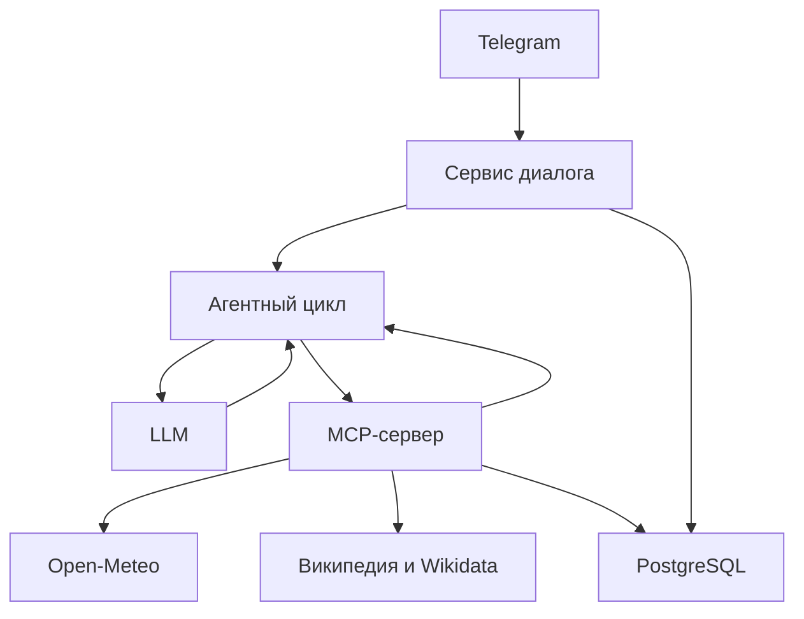

# AI-помощник в Telegram

Написан на C# и .NET 10. В одном чате объясняет темы, помогает с кодом, переводит текст, получает погоду и личное расписание, проверяет справочные сведения по источнику. Напоминания сохраняются после подтверждения кнопкой; уведомления по времени пока не отправляются. История, настройки и личные данные хранятся в PostgreSQL.

## Требования

- .NET SDK 10, для контейнерного запуска — Docker с Compose v2.
- Бот от BotFather и ключ OpenAI-совместимого API.
- PostgreSQL 16. Для облачного запуска дополнительно нужен внешний прокси Telegram.

Поддержанные профили Groq: `qwen/qwen3.8-27b` и `openai/gpt-oss-120b`.
Пользователь выбирает модель и креативность в настройках. Модель из `LLM_MODEL`
используется по умолчанию и при запуске эксперимента.

## Настройка

Скопируйте `.env.example` в `.env` и заполните секреты и параметры своей БД.
Файл располагается рядом с `IntellectBot.sln`.

```dotenv
LLM_BASE_URL=https://api.groq.com/openai/v1
LLM_MODEL=openai/gpt-oss-120b
```

`BOT_TOKEN`, `LLM_API_KEY`, `POSTGRES_PASSWORD` обязательны. Прокси Telegram
задаётся отдельно через `TELEGRAM_PROXY_URL`; запросы к LLM и погоде через него
не направляются. Переменные процесса имеют приоритет над `.env`.

Для первоначального создания отдельной локальной БД:

```bash
bash scripts/start.sh --setup-only
```

Если БД уже работает, используйте её параметры. Вторую БД создавать не нужно.
Не меняйте пароль существующей БД только в `.env`: сначала изменяется пароль
роли PostgreSQL, затем согласованно обновляется конфигурация приложения.

## Локальный запуск

```bash
dotnet restore --locked-mode
dotnet build -c Release --no-restore
dotnet run --project src/IntellectBot -- dbcheck
dotnet run --project src/IntellectBot
```

Остановка — Ctrl+C. В отдельном терминале:

```bash
dotnet run --project src/IntellectBot -- healthcheck
```

## Запуск приложения в Docker с существующей БД

Остановите локальный процесс бота. Для существующего контейнера PostgreSQL:

```bash
bash scripts/run-bot-docker.sh itmo-local-fb4295feeb-db-1
```

Скрипт определяет сеть и volume существующей БД, пересобирает только приложение
и запускает контейнер `intellect-bot`. БД, её контейнер и данные сохраняются.
MCP-сервер запускается дочерним процессом внутри контейнера приложения.

```bash
docker logs --tail 100 intellect-bot
docker exec intellect-bot dotnet IntellectBot.dll healthcheck
docker stop intellect-bot
docker start intellect-bot
```

После изменения кода используйте `run-bot-docker.sh`: обычный `docker start`
запускает уже собранный образ. Не запускайте одновременно два polling-процесса
с одним Telegram-токеном.

Образ — шаблон файлов и зависимостей; контейнер — работающий процесс из образа;
volume — постоянные данные PostgreSQL. Удаление контейнера приложения не удаляет
расписание, историю и напоминания. Volume БД удалять не нужно.

## Интерфейс

- «Новый чат» очищает историю; настройки, расписание и напоминания сохраняются.
- «Возможности» → «Показать инструменты» показывает обнаруженный каталог MCP.
- «Настройки» содержит креативность, часовой пояс, расписание и выбор модели.
- «Другой пояс» принимает IANA-название, например `Asia/Tokyo`.
- Выбранный пояс отмечается ✓. После смены отметка переносится; у своего пояса,
  отсутствующего среди кнопок, отметки на кнопках городов нет. Новый пояс показан
  в настройках, а изменение подтверждается отдельным сообщением.
- Расписание вводится кнопками и сохраняется после просмотра и подтверждения.
- Нельзя сохранить расписание на прошедшую дату в выбранном часовом поясе.
- При неоднозначном городе отправьте номер показанного варианта. Можно вернуться
  к другому номеру исходного списка в течение пяти минут.

Команды: `/start`, `/settings`, `/reset`, `/why`. Меню команд, их описания,
описание бота и аватар настраиваются через BotFather. Приложение не перезаписывает
список команд при запуске. Удалённые команды возвращают сообщение о неизвестной команде.

`/why` показывает последнюю запись решения текущего пользователя: время до минут,
пояс отдельной строкой, действие, инструмент, безопасные аргументы, проверку,
выполнение и причину. Системные инструкции, чужие данные и скрытые рассуждения
не показываются.

## Агентный цикл



Сервер объявляет имена, описания, inputSchema, outputSchema и права инструментов.
Клиент обнаруживает каталог через `tools/list`. Аргументы и результаты проверяются
общим `JsonSchemaValidator`; сервер повторяет проверку на своей границе.
Новый инструмент чтения не требует новой ветки маршрутизации в клиенте.

Обе модели используют нативный function calling через общий `AgentToolProtocol`.
Обычный корректный ответ генерируется одним запросом. Некорректный function calling,
пустой ответ, короткое эхо или смешение алфавитов допускают одно исправление
моделью до исполнения инструмента. Произвольный HTTP 400 повторно не отправляется. После MCP данные возвращаются модели
сообщением `tool` с соответствующим `tool_call_id`. Модель выбирает ответ,
уточнение или следующий вызов. Погодные значения отображаются из серверного
`public_text`. Для справки модель группирует номера фрагментов `facts` по разделам;
приложение проверяет индексы и подставляет текст источника. Модель не может заменить страну, числа, время или дописать биографию. Лимит — два MCP-действия на сообщение.
Служебное уточнение не выполняет MCP и не изменяет данные.

Запись требует доверенного адаптера подготовки и подтверждения пользователя.
Для напоминания сервер проверяет подпись владельца, точные параметры, срок
и идемпотентность; одно действие создаёт не более одного напоминания.
Повторный запрос с тем же текстом и моментом времени не создаёт новую запись
для того же пользователя. Регистр и повторные пробелы не меняют тождество.
Миграция сохраняет ранее записанные данные, включая существующие дубликаты.
Ответ «да» не заменяет нажатие кнопки подтверждения.

## Расход запросов и качество ответа

- Общий HTTP-транспорт и координатор квоты используются обоими LLM-клиентами.
- Учитываются `Retry-After`, исчерпанные остатки запросов/токенов и время сброса.
  Положительный остаток токенов не блокируется приблизительной оценкой запроса.
- Короткое ограничение ожидается в пределах установленного бюджета; после `429`
  допускается не более одного повтора. Модель автоматически не подменяется.
- Русские данные передаются компактным JSON без раздувания `\uXXXX`.
- Для маршрутизации погоды, справки и напоминаний и для ответа после MCP
  применяется короткий бюджет генерации; обычные объяснения сохраняют 4096 токенов.
- При выборе номера передаются выбранное место и его результат, а не вся история
  списка. Сам список остаётся привязанным к пользователю.
- После ограничения квоты полученный MCP-результат можно продолжить повтором
  того же запроса или номера в течение двух минут без повторного вызова MCP.

Эти меры сокращают расход; они не увеличивают квоты провайдера. При суточном
ограничении нужно дождаться сброса либо выбрать другую доступную модель.
Креативность управляет вариативностью, а полнота ответа задаётся инструкциями.
Оборванный ответ API и короткое эхо запроса не выдаются как успешный результат.
Код сохраняет отступы и отображается моноширными блоками, обычный текст очищается
от Markdown-маркеров. Таблицы преобразуются в вертикальные карточки строк:
это сохраняет все столбцы и читается на узком экране Telegram. Таблицы и символы
внутри программного кода не изменяются. Стрелка в погодном заголовке сама по себе не включает
режим перевода: учитываются запрос пользователя и названия языков.

| Переменная | По умолчанию | Назначение |
|---|---:|---|
| `LLM_MAX_COMPLETION_TOKENS` | 4096 | Обычный ответ, включая бюджет рассуждений модели |
| `LLM_TOOL_RESPONSE_MAX_TOKENS` | 1024 | Верхний предел итога после MCP |
| `LLM_HISTORY_MAX_MESSAGES` | 12 | История целыми парами сообщений |
| `LLM_CONTEXT_MAX_CHARS` | 6000 | Обычный контекст в Unicode-кодовых точках |
| `LLM_TOOL_CONTEXT_MAX_CHARS` | 12000 | Контекст с результатами инструментов |
| `LLM_MAX_RATE_WAIT_SECONDS` | 5 | Бюджет ожидания квоты; допустимо 1–90 секунд |
| `LLM_TIMEOUT_SECONDS` | 60 | Таймаут одного HTTP-запроса |

Существующий `.env` имеет приоритет над значениями примера. Compose и облачная
упаковка передают эти параметры. Суточные и минутные ограничения действуют также
на другие процессы, использующие квоту той же организации.

Публичная погода кэшируется на две минуты, поиск мест — на шесть часов.
Одновременные одинаковые запросы источника объединяются; выбор ID не повторяет
геопоиск. Сетевой запрос источника ограничен восемью секундами. Кэш не содержит
историю, личное расписание или напоминания. Первый запрос зависит от сети и API;
мгновенный ответ не гарантируется. Журнал отдельно показывает `queue_ms`,
`quota_ms`, `http_ms` и длительность этапов агента.

Биографии и возраст проверяются через `get_reference`: выдержка русской Википедии,
ссылка на конкретную версию статьи, при наличии точной даты — возраст из Wikidata.
Запрос Telegram-ссылки использует `intent=telegram`: имя аккаунта берётся из Wikidata,
при отсутствии подтверждения адрес не угадывается. Заголовки имён отображаются в
обычном порядке, без инверсии «Фамилия, Имя».
Если источник не найден или неоднозначен, бот уточняет запрос; при ошибке не
составляет биографию по памяти. Источник также может ошибаться, а обычные ответы
по знаниям модели не считаются автоматически проверенными.

Удаление `LLM_TIMEOUT_SECONDS` безопасно: используется значение по умолчанию 60.
Это предел одного HTTP-вызова, а не обязательная задержка. При наличии старого
`LLM_MAX_RATE_WAIT_SECONDS=60` в `.env` измените его на `5` явно.

## Структура

| Каталог | Ответственность |
|---|---|
| `src/IntellectBot/Telegram` | Команды, кнопки, временный ввод и форматирование |
| `src/IntellectBot/Domain` | История и сценарии диалога |
| `src/IntellectBot/Agent` | Цикл, протокол функций, исполнение шага, подготовка и аудит |
| `src/IntellectBot/Llm` | HTTP, разбор ответа, возможности моделей и координация квоты |
| `src/IntellectBot/Mcp` | Обнаружение каталога, stdio и доверенные вызовы |
| `src/IntellectBot/Application` | Временные сценарии и редактор расписания |
| `src/IntellectBot/Hosting` | Сборка зависимостей, polling и health |
| `src/IntellectBot.Shared` | Контракты, модели, подписи, миграции и SQL-репозитории |
| `src/IntellectBot.McpServer` | Реализация инструментов и ресурса расписания |
| `tests/IntellectBot.Tests` | Автономные и PostgreSQL-тесты по обязанностям |
| `tools/IntellectBot.Checks` | Проверки отдельного MCP-процесса и эксперимент |

## Проверки и эксперимент

```bash
dotnet test -c Release --no-build
dotnet format whitespace . --folder --verify-no-changes
bash scripts/test-db.sh
dotnet run --project tools/IntellectBot.Checks -c Release --no-build
dotnet run --project tools/IntellectBot.Checks -c Release --no-build -- --gateway
dotnet run --project tools/IntellectBot.Checks -c Release --no-build -- --negative
dotnet run --project tools/IntellectBot.Checks -c Release --no-build -- --sources
```

PostgreSQL-тесты создают отдельный временный контейнер; рабочую БД не используют.
Windows: `scripts/test-db.ps1`. Для прямого запуска нужны `RUN_DB_TESTS=1`
и `TEST_DATABASE_URL` отдельной тестовой БД.

Фактические результаты: [проверки](docs/VALIDATION.md).
Маршрутизация измеряется на неизменном наборе из 12 запросов:

Команда для запуска эксперимента:
```bash
dotnet run --project tools/IntellectBot.Checks -c Release --no-build -- --routing verification
```

Эксперимент выполнен 22.10.2026 на модели `qwen/qwen3.8-27b` при temperature 0.3.

| Версия | Точность действий | Точность аргументов |
|---|---:|---:|
| baseline | 12/12 — 100,00% | 7/9 — 77,78% |
| revised | 12/12 — 100,00% | 9/9 — 100,00% |

Итоговый revised достиг порогов 10/12 действий и 8/9 аргументов; baseline
не достиг порога аргументов. Эти числа относятся только
к условиям и каталогу в их `configuration.json`, а не к любому состоянию проекта.
Для измерения текущей сборки создавайте отдельный запуск с новым именем;
сохранённые отчёты не перезаписывайте.

Условия, ошибки и ограничения: [анализ эксперимента](docs/lab2-experiment/analysis.md).

Условия фиксируются в `configuration.json`. Продолжение разрешено только при совпадении модели, настроек, инструкций, схем, набора и сборок. Неполный запуск не получает итоговых метрик; напоминания в эксперименте не записываются.

## Облачный запуск

Локальная работоспособность не подтверждает облачный деплой. Для сервера используется отдельный `.env.cloud` и внешний прокси Telegram:

```bash
docker compose --project-name intellect-csharp --env-file .env.cloud --profile cloud up -d --build --wait
bash scripts/deploy.sh up --ssh-cidr ВАШ_ПУБЛИЧНЫЙ_IP/32
bash scripts/deploy.sh status
bash scripts/deploy.sh logs
bash scripts/deploy.sh stop
```

Учётные данные `yc`, состояние ресурсов и SSH-ключ находятся только на вашем
компьютере. Сохраняйте `.deploy`, пока существуют ресурсы. `stop` сохраняет диск;
`destroy` после подтверждения удаляет собственные ресурсы вместе с диском БД.
Секреты, `.env`, `.env.cloud`, `.deploy` и дампы не публикуются.

Подробности: [агент и расширение](docs/AGENT.md), [интеграционные и ручные проверки](docs/INTEGRATION.md), [спецификация](spec.md).

## Контекст и представление

Длинный прошлый ответ сокращается только в контексте модели до 800 символов;
вопрос сохраняется. Полный текст в БД и Telegram не изменяется. При смене модели
история не очищается. Повторный шаг после MCP содержит текущий вопрос, парные
вызовы и компактное представление полученных данных. Это уменьшает расход токенов,
но не отменяет ограничения провайдера.

Перевод содержит русские названия языков и отдельный моноширный копируемый текст.
Направление определяется текущим запросом, включая «теперь на …».
Простые математические выражения вне кода преобразуются в читаемые символы:
степени, дроби и корни; полноценная вёрстка LaTeX не реализована.
Неправильный заголовок допускает одно исправление моделью. Предпросмотр ссылок
отключён: дополнительные карточки не меняют вид сообщения. Ширину пузыря
определяет Telegram, приложение не задаёт её в пикселях.

При поиске города сервер может выбрать явно преобладающий административный центр:
население не менее 50 тысяч и более чем в 20 раз выше остальных найденных вариантов.
Явный регион и выбранный ID имеют приоритет; сопоставимые города требуют уточнения.
Неизвестные переводы регионов не заменяются выдуманными русскими названиями.
